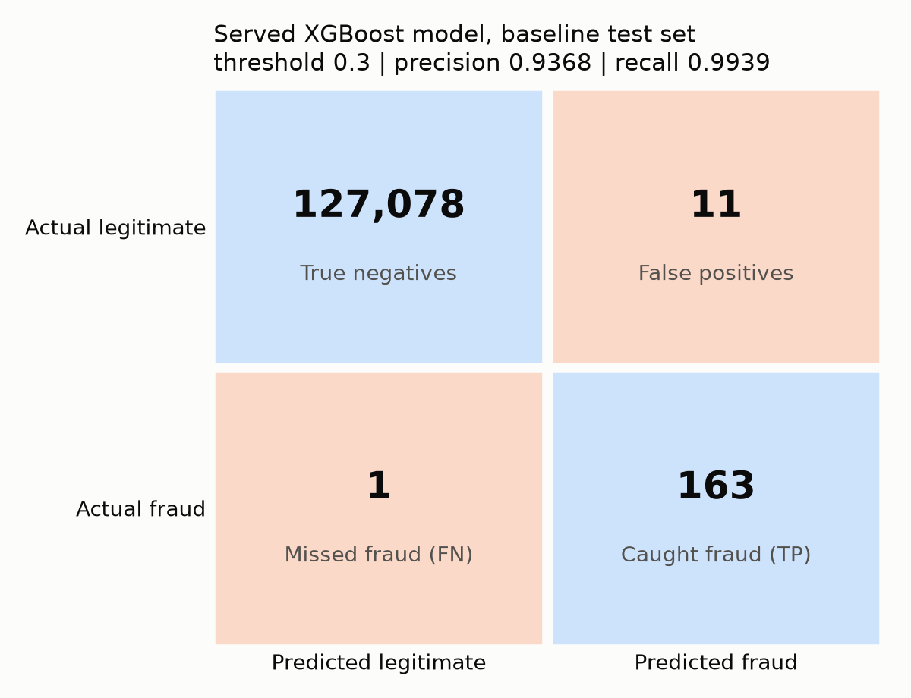
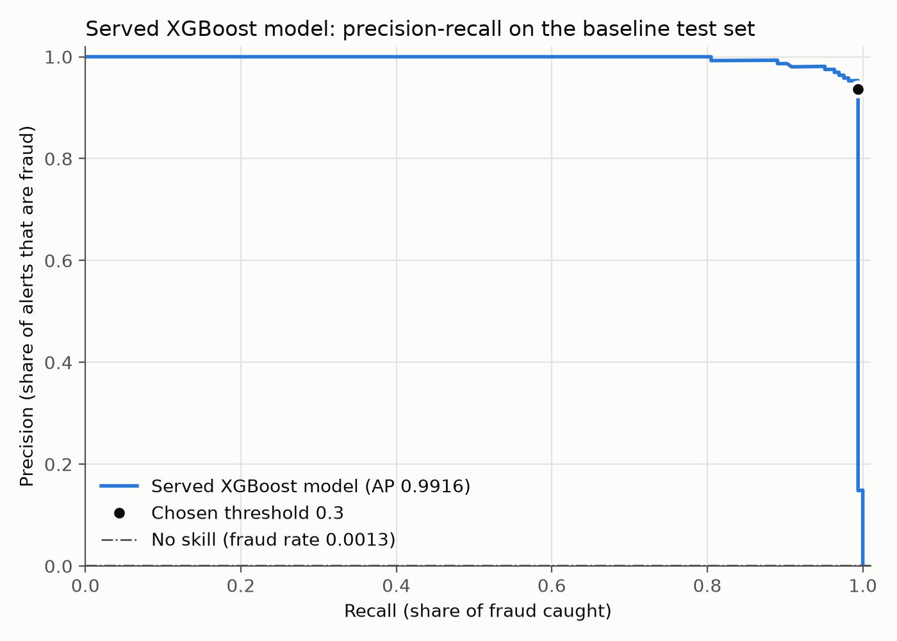
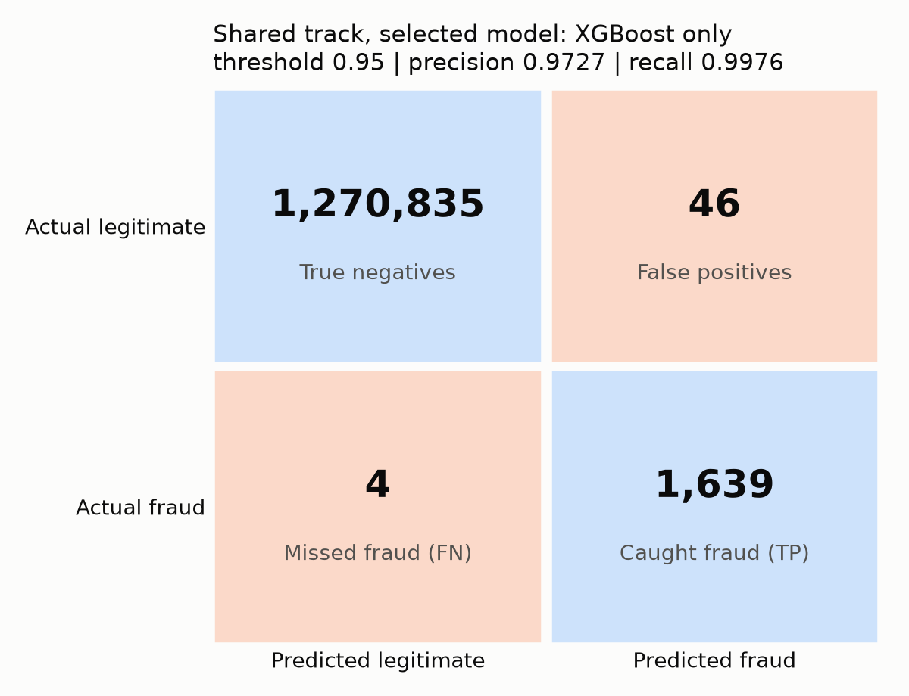
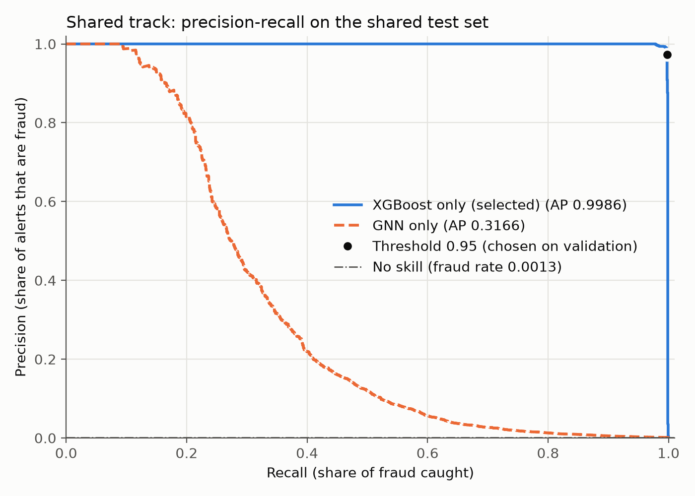

# PaySim Transaction Fraud Detection

**Live demo:** [fraud-detection-bafreen11.netlify.app](https://fraud-detection-bafreen11.netlify.app) · **API docs:** [fraud-api-bafreen11.onrender.com/docs](https://fraud-api-bafreen11.onrender.com/docs)

*Both are on free hosting that sleeps after 15 idle minutes, so the first request can take a minute to wake up.*

Fraud detection on the [PaySim](https://www.kaggle.com/datasets/ealaxi/paysim1) synthetic mobile-money dataset. It combines a gradient-boosted classifier (XGBoost) with a graph neural network (GraphSAGE) over the account-to-account transaction graph, and serves the model through a FastAPI scoring service fed by a Kafka stream.

## Results

PaySim is 0.13% fraud, so accuracy is not reported (flagging nothing would be 99.87% accurate). Every result below states its data, split, threshold and the artifact and script it comes from. Thresholds, blend weights and the GNN training method are always chosen on a **validation** set; the **test** set is scored once afterwards.

| Result | Model artifact | Data and split | Test set | Threshold (chosen on) | Avg. precision | Precision | Recall | F1 | False alarms / missed fraud | Script → report |
|---|---|---|---|---|---|---|---|---|---|---|
| **Baseline API model (served on :8000)** | `models/fraud_xgboost_validated_model.joblib` | 10% stratified sample of PaySim → 70% train / 10% validation / 20% test | 127,253 rows, 164 fraud | 0.3 (validation F1) | **0.9916** | **0.9368** | **0.9939** | **0.9645** | 11 / 1 | `scripts/xgboost/plot_evaluation_figures.py` → `outputs/reports/served_model_test_results.csv` |
| Baseline, first model | `models/fraud_xgboost_model.joblib` | same sample → 80% train / 20% test | same 127,253 rows | 0.5 (fixed, not tuned) | 0.9919 | 0.9588 | 0.9939 | 0.9760 | 7 / 1 | `scripts/xgboost/evaluate_model.py` → `outputs/reports/evaluation_results.txt` |
| **Shared track (XGBoost + GNN blend)** | `models/shared_fraud_xgboost_model.joblib` + `models/shared_fraud_gnn_model.pt` | full data 80/20; train = all fraud + 100k legitimate, 15% of it held out as validation | 1,272,524 rows, 1,643 fraud | 0.95, GNN weight 0 (validation F1, weighted to the real fraud rate) | **0.9986** | **0.9727** | **0.9976** | **0.9850** | 46 / 4 | `scripts/shared/blend_shared_models.py` → `outputs/reports/shared_blend_test_results.csv` |
| Shared track, GNN alone | `models/shared_fraud_gnn_model.pt` | as above | as above | 0.65 (validation F1) | 0.3166 | 0.5277 | 0.2666 | 0.3542 | 392 / 1,205 | same |
| **Stream model (served on :8001)**, version `20261020154142` | `models/stream_xgboost_model.joblib` (19 features incl. Feast recipient history) | shared split; 25% stratified sample of the shared test set, halved into validation / test | 159,066 rows, 206 fraud | 0.95, GNN weight 0 (validation F1) | **0.9993** | **0.9624** | **0.9951** | **0.9785** | 8 / 1 | `scripts/feast/train_stream_model.py` → MLflow experiment `PaySim_Stream_Model` |

The three tracks use different test sets, so compare rows within a track, not across tracks.

Served baseline model on its test set (threshold 0.3):

| Confusion matrix (counts) | Precision-recall curve |
|---|---|
|  |  |

Shared track on the full shared test set (threshold 0.95, XGBoost only, as selected on validation):

| Confusion matrix (counts) | Precision-recall curve |
|---|---|
|  |  |

### How the evaluation was made fair

- **Transaction type.** The baseline originally used 12 numeric features. `scripts/xgboost/compare_transaction_type.py` compared it with a version that adds `type_TRANSFER` / `type_CASH_OUT` on the validation set only (63,627 rows, 82 fraud): average precision 0.9981 → 0.9996, false alarms 12 → 3, no fraud missed in either. The type flags were adopted in training, the saved models, the API input and the Kafka messages (`outputs/reports/transaction_type_comparison.csv`). Before this change the served model scored AP 0.9856, precision 0.8703, recall 0.9817 at threshold 0.4 on the same test set.
- **GNN without an edge shortcut.** During training, a transaction is never in the message-passing graph used to compute its own accounts' embeddings: each epoch splits the training transactions into message edges and scored edges, and accounts without message edges get zero embeddings, as unseen accounts do at test time. The earlier method was compared on validation: AP 0.3156 for the new method vs 0.3098 for the old (`outputs/reports/shared_gnn_strategy_comparison.csv`).
- **Blend chosen on validation.** 6 blend weights × 19 thresholds are compared on the shared validation set (`outputs/reports/shared_blend_validation_selection.csv`). Its legitimate rows are weighted by ~50.8 because `shared_train.csv` keeps only 100,000 of them (~6% fraud vs 0.13% in reality). Adding the GNN never beat XGBoost alone, so the selected weight is 0. The earlier test-set comparison of blend weights was removed.
- **Live replay** (20 Oct 2026): 2,000 transactions from step 600 through Kafka and the fraud service gave 111 alerts, 110 of them real fraud (all 110 frauds caught).

## Project structure

```
├── src/fraud_detection/      Importable package (shared code)
│   ├── config.py             All paths and experiment settings
│   ├── data/                 Loading, quality checks, reproducible splits
│   ├── features/             Feature engineering (baseline, behavioral, stream)
│   ├── models/               GraphSAGE edge classifier and its torch-free export
│   ├── serving/              Stream scorer and case store
│   ├── feature_store.py      Feast access
│   ├── evaluation.py         Threshold metrics, PR curve and confusion-matrix figures
│   └── eda.py                Exploratory analysis functions
├── scripts/                  Runnable pipeline steps
│   ├── data/                 Data checks, EDA, feature engineering, shared split
│   ├── xgboost/              Baseline XGBoost: train, validate, evaluate, figures, track
│   ├── shared/               Shared split: graph, XGBoost, GNN, blending
│   ├── feast/                Feature store, GNN export, stream model
│   ├── monitoring/           Drift check and retraining
│   └── diagnostics/          Model inspection and debugging helpers
├── api/                      fraud_api.py (baseline, :8000), fraud_service.py (streaming, :8001)
├── dashboard/                Streamlit analyst dashboard
├── streaming/                Kafka producers and consumer
├── tests/                    pytest suite
├── docs/                     Walkthrough, architecture, API, test results, demo script
├── models/                   Trained model artifacts (.joblib, .pt)
├── data/processed/           Shared train/test split and training graph
├── outputs/                  Predictions, reports and figures
├── archive/                  Superseded prototype and old scripts
├── mlruns/, mlflow.db        MLflow tracking store
├── Dockerfile*, k8s/         Container images and Minikube manifests
└── pyproject.toml
```

## Setup

Tested on Windows 10 with **Python 3.12.1** (64-bit). Use Python 3.11 or 3.12: numpy 1.26.4, which the saved models need, has no wheels for 3.13. The Docker images use Python 3.11.

| Package | Tested version |
|---|---|
| numpy / pandas / scikit-learn | 1.26.4 / 2.2.3 / 1.3.2 |
| xgboost | 3.2.0 |
| torch (CPU build) / torch_geometric | 2.14.1 / 2.8.1 |
| fastapi / uvicorn / pydantic | 0.143.1 / 0.35.0 / 2.14.1 |
| feast / pyarrow | 0.47.0 / 25.0.1 |
| mlflow / evidently / streamlit | 3.17.1 / 0.7.23 / 1.66.0 |

```bash
pip install torch==2.14.1 --index-url https://download.pytorch.org/whl/cpu
pip install -r requirements-dev.txt
pip install --no-deps pyarrow==25.0.1   # see the note in requirements-dev.txt
pip install -e .
```

`requirements.txt` holds only the baseline API's dependencies (the API image installs nothing else). `pip check` reports one known conflict: Feast 0.47 asks for pyarrow<18.1, but pyarrow 18 breaks `import torch` on Windows, and Feast works with 25.0.1.

The raw dataset is expected at `E:\paysim.csv` and the engineered dataset at `E:\paysim_features.csv`. To use other locations, set the `PAYSIM_RAW_PATH` and `PAYSIM_FEATURES_PATH` environment variables.

## Usage

Run every command from the project root.

```bash
# 1. Data
python scripts/data/run_data_checks.py
python scripts/data/run_eda.py
python scripts/data/run_feature_engineering.py      # writes paysim_features.csv

# 2. Baseline XGBoost (10% stratified sample)
python scripts/xgboost/train_model.py
python scripts/xgboost/compare_transaction_type.py # validation-only feature comparison
python scripts/xgboost/validate_and_test_model.py   # picks threshold -> model served by the API
python scripts/xgboost/plot_evaluation_figures.py   # served model: confusion matrix, PR curve
python scripts/xgboost/evaluate_model.py
python scripts/xgboost/track_experiment.py          # log to MLflow

# 3. Shared split: XGBoost + GNN blend
python scripts/data/create_shared_split.py
python scripts/shared/build_shared_train_graph.py
python scripts/shared/train_shared_xgboost.py
python scripts/shared/train_shared_gnn.py
python scripts/shared/blend_shared_models.py       # weight + threshold on validation, then test once
```

### API

```bash
uvicorn api.fraud_api:app --port 8000
# or
docker build -t fraud-api . && docker run -p 8000:8000 fraud-api
```

`POST /predict` with the six raw numeric fields and the transaction type (`PAYMENT`, `TRANSFER`, `CASH_OUT`, `DEBIT` or `CASH_IN`):

```json
{"step": 1, "type": "TRANSFER", "amount": 181, "oldbalanceOrg": 181,
 "newbalanceOrig": 0, "oldbalanceDest": 0, "newbalanceDest": 0}
```

The response contains `fraud_probability`, `predicted_label`, `decision` (`FRAUD_ALERT` / `LEGITIMATE`) and `threshold`. Invalid input (missing fields, unknown type, negative, NaN or infinite numbers) gets a 422 that names the field. An unexpected error gets a 500 with only a generic message and an error id; the details are in the server log. Interactive docs are at `/docs`.

### Streaming

With Kafka at `localhost:9092` and the API running:

```bash
python streaming/kafka_paysim_producer.py
python streaming/kafka_fraud_consumer.py
```

### Experiment tracking

```bash
mlflow ui --backend-store-uri sqlite:///mlflow.db --port 5000
```

## Streaming platform (Feast, live scoring, drift, dashboard)

A third track turns the models into a live system:

```
paysim.csv ──► replay producer ──► Kafka "transactions" ──► fraud service (FastAPI, :8001)
                                                             │  1. recipient state from Feast online store
                                                             │  2. features (same code as training)
                                                             │  3. XGBoost + GNN blended score
                                                             │  4. updated recipient state back to Feast
                                                             │  5. case saved (SQLite) ─► analyst dashboard (Streamlit, :8501)
                                                             └─ 6. alert ─► Kafka "fraud_alerts"
drift monitor (Evidently) ──► drift report + MLflow ──► retrain ──► promote if not worse ──► service reloads model
```

### Features in Feast

PaySim senders almost never repeat (99.7% appear once), so history is kept per **recipient** account. Feast stores each recipient's running state (`txn_count`, `amount_sum`, `last_step`, `day_txn_count`) as point-in-time snapshots. The model gets five behavioral features from it: previous transaction count, same-day count (velocity), steps since the last transaction, previous mean amount, and amount relative to that mean. It also gets the 14 baseline features, including the TRANSFER/CASH_OUT flags (19 in total). Training reads the state from the Feast offline store with point-in-time joins. The service reads it from the online store and writes the update after every transaction. For 500 streamed transactions the served features were identical to the training features (max difference 0.0).

PaySim has no device, location or card fields, so the device/location features and a device/card graph are not possible with this dataset (IEEE-CIS has them).

### Stream model results

Test half of a 25% stratified sample of `shared_test.csv` (159,066 transactions, 206 fraud). The GNN weight and threshold were picked on the other half. The production model, version `20261020154142`, was trained automatically after a drift alert, with 2 analyst feedback labels, and promoted because its test average precision was not worse than the previous model's:

| Version | Trigger | GNN weight / threshold | Average precision | Precision | Recall | F1 |
|---|---|---|---|---|---|---|
| `20261020152028` | manual | 0.1 / 0.90 | 0.9989 | 0.9624 | 0.9951 | 0.9785 |
| **`20261020154142` (production)** | drift (share 0.68) | **0.0 / 0.95** | **0.9993** | **0.9624** | **0.9951** | **0.9785** |

The GNN serving artifact now comes from the GNN trained without the edge shortcut; with GNN weight 0 the production scores are unchanged.

### One-time setup

```bash
python scripts/feast/build_feature_store.py      # Feast source, registry, online store up to REPLAY_START_STEP
python scripts/feast/export_gnn_for_serving.py   # GNN embeddings + weights for torch-free serving
python scripts/feast/train_stream_model.py       # stream model, MLflow experiment PaySim_Stream_Model
```

### Run

In VS Code choose **Run streaming platform (Feast + dashboard)** and press F5. It starts Kafka, the fraud service, the dashboard, MLflow, the drift monitor and the replay producer. Or by hand:

```bash
docker compose up -d --wait kafka
uvicorn api.fraud_service:app --port 8001
streamlit run dashboard/app.py                                  # http://localhost:8501
python streaming/kafka_replay_producer.py                       # REPLAY_MAX_TRANSACTIONS, REPLAY_DELAY_SECONDS
DRIFT_CHECK_INTERVAL_SECONDS=300 python scripts/monitoring/check_drift.py
```

Before replaying again, stop the service and run the task **setup: reset replay**. Otherwise recipient history is counted twice.

Service endpoints: `GET /` health, `POST /score`, `GET /stats`, `GET /transactions`, `GET|PATCH /cases/{id}` (status `OPEN → INVESTIGATING → CONFIRMED_FRAUD | FALSE_POSITIVE → CLOSED`, label `FRAUD | LEGITIMATE`, note), `GET /drift/latest`, `GET /drift/report`, `POST /model/reload`.

### Drift monitoring and automatic retraining

`scripts/monitoring/check_drift.py` compares the feature vectors of the latest served transactions with the reference saved at training time, using Evidently's DataDriftPreset. It saves an HTML report, logs a run to the MLflow experiment `PaySim_Drift_Monitoring` and, when the share of drifted features reaches `DRIFT_SHARE_THRESHOLD` (default 0.5), runs `train_stream_model.py` (12-hour cooldown). The new model includes the analyst feedback labels. It replaces the current model only if its test average precision is not worse, it is registered in the MLflow model registry as `paysim-stream-xgboost`, and the service is told to reload it.

### Docker and Kubernetes (Minikube)

```bash
docker compose --profile platform up -d --build --wait     # Kafka + service + dashboard in containers

minikube start --memory=6g --cpus=4
minikube image build -t fraud-service:latest -f Dockerfile.service .
minikube image build -t fraud-dashboard:latest -f Dockerfile.dashboard .
kubectl apply -k k8s/
kubectl -n fraud-detection port-forward svc/fraud-service 8001:8001
kubectl -n fraud-detection port-forward svc/fraud-dashboard 8501:8501
minikube mount E:\:/paysim                                 # separate terminal, for the producer job
kubectl apply -f k8s/replay-producer-job.yaml
```

In the cluster the Feast online store starts empty and is filled by the stream, and the drift CronJob reports every 30 minutes but does not retrain, because training needs the raw data on the host.

## Documentation and tests

- [docs/WALKTHROUGH.md](docs/WALKTHROUGH.md): every step, in order, with what it reads and writes
- [docs/ARCHITECTURE.md](docs/ARCHITECTURE.md): system diagram, components, design decisions, data documentation
- [docs/API.md](docs/API.md): both APIs' endpoints, request and response formats, errors
- [docs/TEST_RESULTS.md](docs/TEST_RESULTS.md): test-suite results and all model metrics
- [docs/DEMO_SCRIPT.md](docs/DEMO_SCRIPT.md): a 5-minute demo

```bash
python -m pytest
```

The suite covers the feature code, both APIs (including error handling), the case store and model-quality gates on held-out data. The service tests run with Kafka off and a temporary database.
