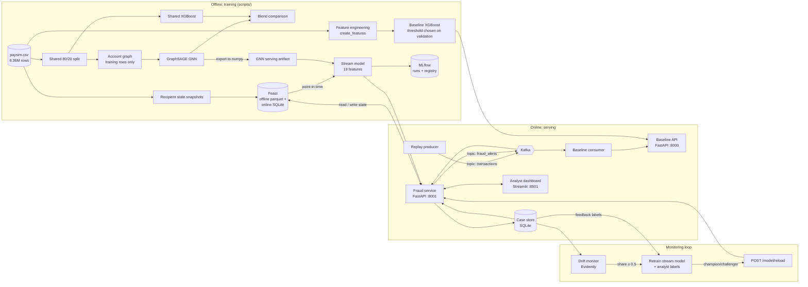
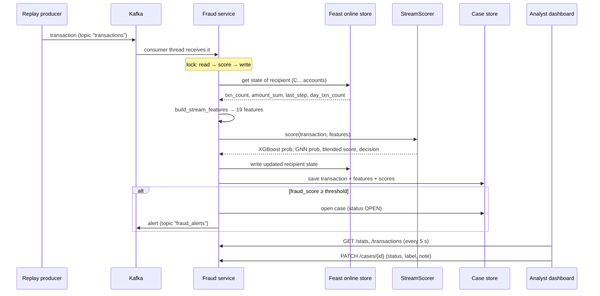

# Architecture and data

## 1. System overview

## 2. Scoring one streamed transaction

## 3. Components

| Component | File(s) | Technology | Role |
|---|---|---|---|
| Configuration | `src/fraud_detection/config.py` | Python | every path and setting, overridable by environment variables |
| Baseline features | `src/fraud_detection/features/engineering.py` | pandas | 14 features; the only implementation, used by training and the API |
| Behavioral features | `src/fraud_detection/features/behavioral.py` | pandas, numpy | recipient state (offline and streaming versions) and 5 features derived from it |
| Stream features | `src/fraud_detection/features/stream.py` | pandas | 19-feature vector for the stream model |
| Feature store | `src/fraud_detection/feature_store.py`, `feature_repo/` | Feast 0.47 | offline parquet store (training), SQLite online store (serving) |
| GNN | `src/fraud_detection/models/gnn.py` | PyTorch Geometric | GraphSAGE encoder + edge classifier |
| GNN serving | `src/fraud_detection/models/gnn_serving.py` | numpy | torch-free GNN scoring from exported embeddings |
| Scorer | `src/fraud_detection/serving/scorer.py` | XGBoost | blends XGBoost and GNN; hot reload |
| Case store | `src/fraud_detection/serving/case_store.py` | SQLite | scored transactions, cases, analyst feedback |
| Baseline API | `api/fraud_api.py` | FastAPI | stateless scoring of 6 raw fields + `type` |
| Fraud service | `api/fraud_service.py` | FastAPI + kafka-python | streaming scoring, cases, drift and reload endpoints |
| Dashboard | `dashboard/app.py` | Streamlit | analyst UI; talks only to the service API |
| Drift monitor | `scripts/monitoring/check_drift.py` | Evidently 0.7 | drift reports, retraining trigger |
| Experiment tracking | `mlflow.db`, `mlruns/` | MLflow | runs, metrics, artifacts, model registry |
| Message bus | `docker-compose.yml` | Apache Kafka 3.9 (KRaft) | topics `transactions`, `fraud_alerts` |
| Deployment | `Dockerfile*`, `docker-compose.yml`, `k8s/` | Docker, Minikube | containers and Kubernetes manifests |

## 4. Design decisions

| Decision | Why |
|---|---|
| Measure precision, recall, F1 and average precision, never accuracy | 0.13% fraud: a model that always says "legitimate" is 99.87% accurate |
| Class weighting (`scale_pos_weight`) | stops the model from ignoring the rare fraud class |
| Threshold and blend weight chosen on **validation**, reported on **test** | choosing them on test would overstate the results |
| One feature function shared by training and serving | prevents training/serving skew; covered by tests |
| GNN graph built from training rows only; unseen accounts get zero embeddings | prevents test leakage; matches reality for new customers |
| History per **recipient**, not sender | 99.7% of PaySim senders appear only once |
| Point-in-time lookups at timestamp − 1 ms | a transaction must not see its own effect or the future |
| GNN exported to numpy | keeps PyTorch (1+ GB) out of the service image |
| Champion/challenger promotion with archived models | a retrain can never silently make production worse |
| Read-score-write under one lock | two transactions to one account can't read stale state |

## 5. Data documentation

### 5.1 Source dataset: PaySim (`E:\paysim.csv`)

Synthetic mobile-money transactions from Kaggle (*PaySim1*), simulated from real logs of an African mobile-money service.

| | |
|---|---|
| Rows | 6,362,620 |
| Fraud rows | 8,213 (0.129%) |
| Time span | steps 1 to 743 (1 step = 1 hour, about 31 days) |
| Missing values / duplicates | none |

| Column | Type | Description |
|---|---|---|
| `step` | int | simulation hour |
| `type` | category | PAYMENT, TRANSFER, CASH_OUT, CASH_IN, DEBIT |
| `amount` | float | amount moved |
| `nameOrig` | string | sender account (`C` + digits) |
| `oldbalanceOrg`, `newbalanceOrig` | float | sender balance before / after |
| `nameDest` | string | recipient account (`C` customer, `M` merchant) |
| `oldbalanceDest`, `newbalanceDest` | float | recipient balance before / after (merchants always 0) |
| `isFraud` | 0/1 | label |
| `isFlaggedFraud` | 0/1 | simulator's rule for transfers over 200,000; not used |

Fraud by type (`outputs/reports/fraud_by_type.csv`):

| Type | Transactions | Fraud | Fraud rate |
|---|---|---|---|
| TRANSFER | 532,909 | 4,097 | 0.77% |
| CASH_OUT | 2,237,500 | 4,116 | 0.18% |
| PAYMENT | 2,151,495 | 0 | 0 |
| CASH_IN | 1,399,284 | 0 | 0 |
| DEBIT | 41,432 | 0 | 0 |

### 5.2 Features

**Baseline (14):** `step, amount, oldbalanceOrg, newbalanceOrig, oldbalanceDest, newbalanceDest, origin_balance_error, destination_balance_error, amount_to_origin_balance, amount_to_destination_balance, step_day, step_hour, type_TRANSFER, type_CASH_OUT`. The two type flags were added after `scripts/xgboost/compare_transaction_type.py` showed better validation results with them (`outputs/reports/transaction_type_comparison.csv`). Formulas are in [WALKTHROUGH.md, Step 3](WALKTHROUGH.md#step-3-create-features-scriptsdatarun_feature_engineeringpy).

**Stream model (19)** = the 14 above +:

| Feature | Definition |
|---|---|
| `dest_txn_count_prev` | transactions the recipient received before this one |
| `dest_txn_count_same_day` | of those, how many on the same simulated day (velocity) |
| `dest_steps_since_last_txn` | hours since the recipient's previous transaction (−1 if none) |
| `dest_amount_mean_prev` | average amount the recipient received before |
| `amount_to_dest_avg` | `amount / (dest_amount_mean_prev + 1)` |

**GNN inputs:** node features `log1p(times sent)`, `log1p(times received)`; edge features: the 6 raw numeric fields, the 5 money fields log-transformed, all standard-scaled.

### 5.3 Splits

| Track | Split | Sizes |
|---|---|---|
| Baseline | 10% stratified sample → 70% train / 10% validation / 20% test | test: 127,253 rows, 164 fraud |
| Shared | full data 80/20 stratified; train = all fraud + 100,000 legitimate | train 106,570 rows; test ≈ 1.27M rows (kept whole) |
| Stream | shared split; 25% of the test side halved | validation 159,065 / test 159,066 rows (206 fraud) |

Random seed: 42 everywhere (`config.RANDOM_STATE`).

### 5.4 Generated data and artifacts

| Path | Produced by | Contents |
|---|---|---|
| `E:\paysim_features.csv` | `run_feature_engineering.py` | raw data + 6 engineered features + 2 type flags |
| `data/processed/shared_train.csv`, `shared_test.csv` | `create_shared_split.py` | the shared split |
| `data/processed/shared_train_graph.pt` | `build_shared_train_graph.py` | PyTorch Geometric graph |
| `data/processed/drift_reference_features.parquet` | `train_stream_model.py` | 20,000 validation feature vectors (drift baseline) |
| `feature_repo/data/recipient_stats.parquet` | `build_feature_store.py` | recipient state after every transaction (Feast offline source) |
| `feature_repo/data/online_store.db` | `build_feature_store.py`, fraud service | latest recipient state (Feast online store) |
| `data/serving/fraud_cases.db` | fraud service | table `scored_transactions` (see below) |
| `models/fraud_xgboost_validated_model.joblib` | `validate_and_test_model.py` | `{model, feature_columns, threshold}`; served on :8000 (14 features, threshold 0.3) |
| `models/shared_fraud_gnn_model.pt` | `train_shared_gnn.py` | GNN weights, account map, scaler |
| `models/gnn_serving_artifact.joblib` | `export_gnn_for_serving.py` | embeddings + classifier weights (numpy) |
| `models/stream_xgboost_model.joblib` | `train_stream_model.py` | `{model, feature_columns, threshold, gnn_weight, version}`; served on :8001 |
| `models/archive/` | `train_stream_model.py` | every candidate and the previous production model |
| `outputs/reports/drift/` | `check_drift.py` | HTML reports, `latest_summary.json`, `retrain_state.json` |

### 5.5 Case store table `scored_transactions`

| Column | Meaning |
|---|---|
| `id` | case / record ID |
| `transaction_id` | row position in `paysim.csv` |
| `scored_at`, `updated_at` | UTC timestamps |
| `step, type, amount, name_orig, name_dest` | transaction summary |
| `transaction_json`, `features_json` | full input and the **exact** feature vector the model saw |
| `xgboost_probability, gnn_probability, fraud_score, threshold, decision, model_version` | scoring result |
| `actual_is_fraud` | true label (known only in a replay) |
| `case_status` | `OPEN, INVESTIGATING, CONFIRMED_FRAUD, FALSE_POSITIVE, CLOSED` (alerts only) |
| `analyst_label`, `analyst_note` | feedback: `FRAUD` / `LEGITIMATE`, used in the next retraining |
